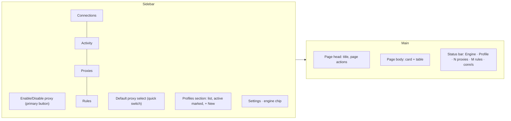

# Rebuild AnyProxyXa UI (AnyProfile look × ProxyBridge UX)

## Outcome

The old UI (`frontend/src/App.tsx` 1966 lines + `frontend/src/styles/app.css` 1130 lines) is gone. A new
frontend, split into `components/`, `pages/`, `hooks/`, `i18n/`, `lib/`, `styles/` like
[AnyProfile](file:///Users/dobby/Heroin/anyprofile/frontend/src), looks like a sibling app of AnyProfile
(same tokens, sidebar, page head, cards, tables, dialogs, light + dark, EN + VI, hidden title bar) and
keeps every ProxyBridge function reachable. The Go backend and `api.ts` bindings do not change.

## Decisions (confirmed by user 2026-11-08)

| # | Question | Choice |
|---|---|---|
| 1 | Language | EN + VI, same `i18n/en.ts`, `vi.ts`, `index.ts` pattern as AnyProfile |
| 2 | Theme | Light + dark following the system, AnyProfile's dark tokens; choice in Settings |
| 3 | macOS window | `mac.TitleBarHiddenInset()`; sidebar + page head are drag regions with room for the traffic lights |
| 4 | Font | Inter Variable via `@fontsource-variable/inter` (bundled, works offline) as in AnyProfile |
| 5 | Precedence | A new `DESIGN.md` records this system; it beats the dealt `design-taste-frontend` direction (IBM Plex) per the user rules. The inspector's font check is expected to flag Inter. That is accepted, everything else must pass. |
| 6 | Button glow | AnyProfile's `--glow` is dropped from buttons (flat fills). Matches the no-slop rule and keeps the inspector clean. |

> [!WARNING]
> License: AnyProfile's CSS and components are `AGPL-3.0-or-later`; AnyProxyXa is `MIT`. Both repos belong to D0bby999,
> so the owner can relicense the copied parts to MIT. The token file is itself adapted from AliasMode (Apache-2.0), so that
> attribution must go into `NOTICE`. Confirm before phase 1 if relicensing is not intended.

## Information architecture (ProxyBridge → AnyProfile shell)

| ProxyBridge place | New place |
|---|---|
| Proxy menu → Enable ProxyBridge | Sidebar primary button (green state when running) + status bar |
| Proxy menu → Proxy Settings | **Proxies** page (table, New proxy dialog, Test dialog with 5 steps) |
| Proxy menu → Proxy Rules | **Rules** page (ordered table, enable switch, row menu, Import/Export) |
| Proxy menu → Log Filters | Connections page head → Filters dialog |
| Profile menu | Sidebar Profiles section + row menu (Rename, Duplicate, Export, Delete) + Import in Settings |
| Settings menu | **Settings** page (Traffic, Appearance & language, Profiles, Version, About) |
| Connections tab + Live Connections | **Connections** page, segmented `Live / Log`, search, Clear, + Rule from row |
| Activity Logs tab | **Activity** page |
| Bottom status bar | `status-bar.tsx`, same fields |

Quick proxy switch (asked earlier): the sidebar select changes `SetDefaultProxy` in one click from any page;
the Proxies table row menu has **Set as default**; per-app routing stays in Rules.

## Feature parity checklist (every binding in `api.ts` keeps a UI)

| Binding | Where |
|---|---|
| `StartupError` | Full-page error card in `App.tsx` |
| `ListProfiles`, `ActiveProfile`, `SwitchProfile`, `CreateProfile`, `DuplicateProfile`, `RenameProfile`, `DeleteProfile` | Sidebar Profiles section |
| `ImportProfileJSON`, `ExportProfileJSON` | Settings → Profiles; profile row menu → Export |
| `SaveProxy`, `DeleteProxy`, `SetDefaultProxy`, `TestProxy` | Proxies page; sidebar quick switch |
| `SaveRule`, `DeleteRule`, `ToggleRule`, `MoveRule`, `CloneRule`, `ImportRulesJSON`, `ExportRulesJSON`, `PickProcessExecutable` | Rules page + rule dialog |
| `StartEngine`, `StopEngine`, `SetEngineEnabled`, `Status` | Sidebar button, engine chip, status bar |
| `UpdateOptions`, `SaveLogFilters` | Settings → Traffic; Connections → Filters |
| `GetFlows`, `ClearClosedFlows`, `GetConnectionLogs`, `ClearConnectionLogs` | Connections page |
| `GetActivityLogs`, `ClearActivityLogs` | Activity page |
| `SimulateFlow` | Preview/dev only (Activity page, shown when running on the stub) |
| `CheckForUpdates` | Settings → Version |

## Phases

| # | Phase | Status |
|---|---|---|
| 1 | [Remove old UI, port design system, shell](./phase-01-design-system-and-shell.md) | Pending |
| 2 | [Shared components and data hooks](./phase-02-components-and-hooks.md) | Pending |
| 3 | [Pages](./phase-03-pages.md) | Pending |
| 4 | [Verify, package, document](./phase-04-verify-and-ship.md) | Pending |

## Non-goals

Backend or binding changes, command palette, keyboard shortcut sheet, drag-to-reorder rules (arrows are enough),
Buy-proxies/partner grid, Pro features, Windows-specific chrome beyond AnyProfile's `html.win` titlebar rule.

## Success criteria

1. `frontend/src/styles/app.css` and the monolithic `App.tsx` no longer exist; no old class names remain (`grep -r "proxy-switcher-pill\|kpi-" frontend/src` is empty).
2. Every row of the parity checklist is reachable and covered by at least one Vitest test.
3. `npm run typecheck && npm test && npm run build` pass; `go test ./...` still passes.
4. `inspect.mjs --app` has 0 FAIL except the accepted font check.
5. Screenshots at 1280×800 and 980×620 (the window's min size), light and dark, EN and VI, look consistent with AnyProfile side by side.
6. `wails build` app launches with a hidden title bar, traffic lights don't overlap content, inbound `127.0.0.1:10800` still listens.

## Risks

| Risk | Mitigation |
|---|---|
| Losing a function while rewriting a 2k-line file | Parity checklist above becomes the test list in phase 3 |
| Drag region swallowing clicks | `.drag` / `.nodrag` classes exactly as AnyProfile; test every sidebar control in the built app |
| VI strings overflow narrow controls | Screenshot VI at 980 px; `text-overflow: ellipsis` on nav labels and selects |
| License mix | Warning above; NOTICE entry in phase 1 |

